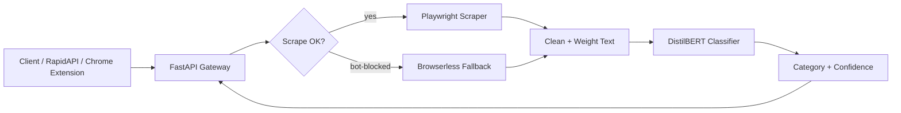

<!-- ═══════════════ HEADER ═══════════════ -->


<p align="center">
  <a href="https://github.com/Sananda-Dutta/Sananda-Dutta">
    
  </a>
</p>

<p align="center">
  <a href="https://www.linkedin.com/in/sananda-dutta-71a26a346/"></a>
  <a href="https://codolio.com/profile/SanandaDutta"></a>
  <a href="https://huggingface.co/SanandaDutta"></a>
  
</p>

---

## 👨‍💻 About Me

```python
class Sananda:
    role      = "Third-year B.Tech Data Science @ NIET, Greater Noida"
    focus     = ["Production ML", "GenAI / RAG", "APIs & Backend", "MLOps"]
    building  = ["OmniRAG", "Website Category Classifier API"]
    goal      = "Top product-company roles + a monetizable SaaS API"
    fun_fact  = "I rebuilt a classifier from 59% to 82.2% accuracy by fixing data leakage, not by changing the model."
```

---

## 🚀 Featured Projects

<table>
<tr>
<td width="50%" valign="top">

### 🌐 Website Category Classifier (WCC)
DistilBERT-powered API that classifies any URL into **11 categories** (News, Education, Gaming, Health, Technology, …).

- 🎯 **82.2%** honest test accuracy (leakage fixed)
- 🧩 Microservices: Playwright scraper + inference service + FastAPI gateway
- 🛡️ Bot-block fallback via Browserless
- 💸 Monetized on **RapidAPI** (Free / Basic / Pro)
- 🔌 Chrome extension for quick testing


🔗 [Model on HuggingFace](https://huggingface.co/SanandaDutta/website-category-distilbert) · [Repo](https://github.com/Sananda-Dutta/REPO_NAME_HERE)

</td>
<td width="50%" valign="top">

### 🧠 OmniRAG — Multi-Modal AI Knowledge Assistant
Production-grade RAG chatbot over **PDF, DOCX, images, web URLs and audio**, with citation-backed answers.

- 🔎 Hybrid retrieval (dense + BM25) with re-ranking
- 🧵 Query rewriting, memory, tool calling
- 📏 RAG evaluation (Ragas / DeepEval) + observability
- ⚙️ FastAPI · PostgreSQL · Qdrant/pgvector · Celery
- 🎨 React + TypeScript + Tailwind frontend


🔗 [Repo](https://github.com/Sananda-Dutta/REPO_NAME_HERE) · *work in progress*

</td>
</tr>
</table>

<details>
<summary><b>🏗️ Click to see how WCC works (architecture)</b></summary>



**Lessons learned:** train/inference mismatch capped early accuracy at ~59%; rebuilding the dataset with real page content and removing seed-word leakage gave an honest 82.2%.

</details>

<details>
<summary><b>📌 Pinned repo cards (auto-updating)</b></summary>
<br/>

<!-- Replace REPO_NAME_HERE with your real repo names -->
<a href="https://github.com/Sananda-Dutta/REPO_NAME_HERE">
  
</a>
<a href="https://github.com/Sananda-Dutta/REPO_NAME_HERE_2">
  
</a>

</details>

---

## 🛠️ Tech Stack

**Languages & ML**


**Backend, Data & DevOps**


**Frontend**


<details>
<summary><b>🧪 More tools I use</b></summary>

`HuggingFace Transformers` · `DistilBERT` · `LIME` · `Playwright` · `Qdrant` · `pgvector` · `Celery` · `Pydantic` · `SQLAlchemy` · `Ragas` · `Langfuse` · `RapidAPI` · `UptimeRobot` · `Google Cloud Run`

</details>

---

## 📊 GitHub Analytics

<p align="center">
  
  
</p>

<p align="center">
  
</p>

<p align="center">
  
</p>

### 🐍 Contribution Snake

<p align="center">
  <picture>
    <source media="(prefers-color-scheme: dark)" srcset="https://raw.githubusercontent.com/Sananda-Dutta/Sananda-Dutta/output/github-snake-dark.svg"/>
    <source media="(prefers-color-scheme: light)" srcset="https://raw.githubusercontent.com/Sananda-Dutta/Sananda-Dutta/output/github-snake.svg"/>
    
  </picture>
</p>

### 🏆 Trophies

<p align="center">
  
</p>

---

## 🧩 Coding Profiles

<p align="center">
  <a href="https://codolio.com/profile/SanandaDutta">
    
  </a>
</p>

---

## 🤝 Let's Connect

<p align="center">
  I'm looking for <b>internships / placements</b> in ML, GenAI and backend engineering.<br/>
  Reach out on <a href="https://www.linkedin.com/in/sananda-dutta-71a26a346/">LinkedIn</a> — happy to chat about ML systems, RAG, or API products.
</p>


